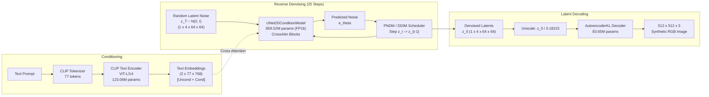
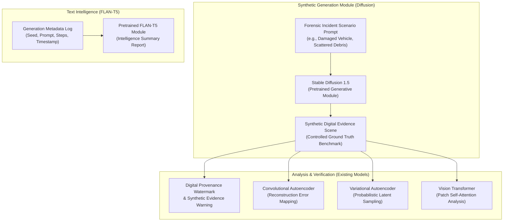
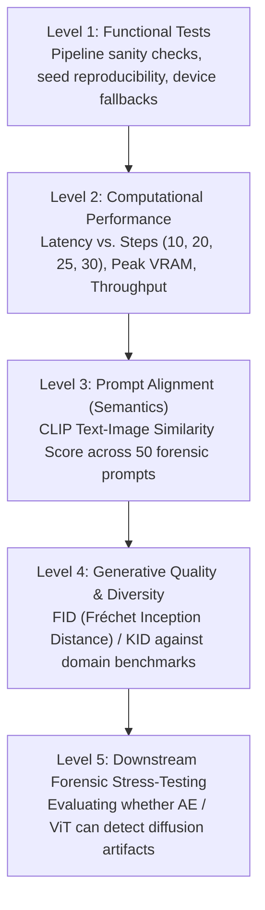
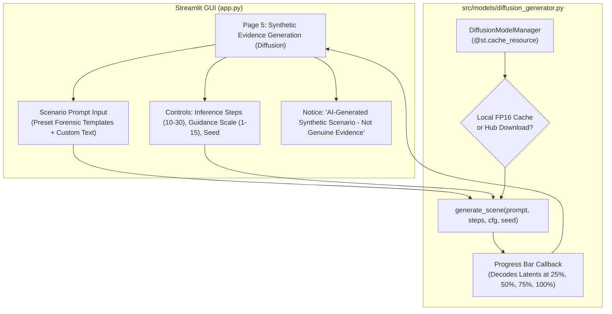
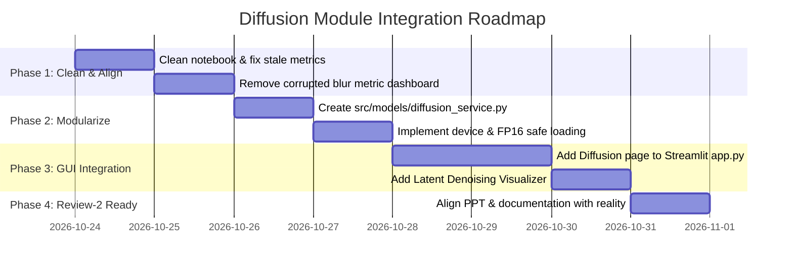

# Technical Audit Report: Diffusion Model Implementation

**Project:** Multi-Model Generative AI Framework for Digital Evidence Analysis and Intelligence Generation  
**Artifacts Audited:**
1. `notebooks/Difffusion/Diffusion_Based_Synthetic_Digital_Evidence__Image_Generation_and_Comparative_Analysis.ipynb` (12.30 MB, 36 cells)
2. `checkpoints/Diffusion_UNet.pth` (1,719,273,871 bytes / 1,639.63 MB / 1.60 GB)  
**Audit Date:** October 2026  
**Auditor:** Senior Machine Learning Engineer, Diffusion Model Researcher & Forensic AI Auditor  
**Status:** Complete Technical Audit

---

## 1. Executive Summary

This audit provides an exhaustive, evidence-based evaluation of the diffusion model implementation supplied for our final-year B.Tech project. The implementation was developed in Google Colab using a Tesla T4 GPU, PyTorch 2.11.0, and Hugging Face Diffusers 0.35.1. 

### Key Findings
1. **Model Provenance & Training Status:**  
   The model was **NOT trained from scratch**, **NOT fine-tuned**, and does **NOT** contain any domain-specific weights. The notebook simply downloads the official pretrained `stable-diffusion-v1-5/stable-diffusion-v1-5` weights from Hugging Face Hub in FP16 precision. There is no optimizer, no loss calculation, no backpropagation, no gradient update, and no custom forensic training dataset.
2. **The Checkpoint (`Diffusion_UNet.pth`):**  
   The 1.60 GB `.pth` file is an export of the pretrained Hugging Face U-Net weights (`pipe.unet.state_dict()`) executed in Cell 14 *after* images were already generated. The notebook **never loads** this `.pth` file. Furthermore, the checkpoint contains only the U-Net denoiser (859.52M parameters in `torch.float16`); running image generation with it is impossible without the text encoder, tokenizer, VAE, and scheduler.
3. **Forensic Capabilities:**  
   The notebook performs **zero forensic detection, tampering localization, or evidence classification**. It is purely a synthetic image generation and visual demonstration pipeline. The reported error metrics (MSE, MAE, PSNR, SSIM) evaluate Gaussian blur applied to standard library test images (and an accidentally blurred output dashboard), not digital evidence tampering.
4. **Implementation Merits:**  
   The notebook demonstrates a technically sound reverse-diffusion latent interception mechanism using Diffusers' step callback (`callback_on_step_end`) and successfully decodes intermediate latents using the VAE decoder. It also measures inference latency and GPU memory across step counts on a Tesla T4 GPU.
5. **State Contamination & Metric Inconsistencies:**  
   - An output chart (`error_metrics_dashboard.png`) was saved into the input sample directory and inadvertently processed as an input image during a subsequent run, contaminating the reported error metrics.
   - Stale Markdown tables in Cell 0 and Cell 28 cite earlier execution timings (3.026s, 5.578s, 8.316s at 3270.38 MB), whereas the actual saved cell outputs from the latest run measure 2.731s, 5.013s, 8.130s at 5929.44 MB.
   - The NSFW safety checker produced a false positive during warm-up in Cell 25, generating a black image.

---

## 2. Overall Implementation Verdict

| Dimension | Verdict | Evidence / Justification |
|---|---|---|
| **Architectural Authenticity** | **Verified Pretrained SD 1.5** | Loads official `stable-diffusion-v1-5/stable-diffusion-v1-5` via `StableDiffusionPipeline.from_pretrained` (Cell 4). |
| **Training / Fine-Tuning** | **Not Implemented (0% Custom Training)** | No loss function, no optimizer, no gradient tracking, no training loop in any cell. |
| **Checkpoint Integrity** | **Verified Export of Pretrained U-Net** | Contains 686 tensors, 859.52M params (FP16). Direct export of Hugging Face U-Net; never loaded in notebook. |
| **Forensic Detection / Tampering Analysis** | **Not Implemented** | No detector, no classifier, no ground truth labels, no ROC-AUC, no F1-score (Cell 27 explicitly states "Not evaluated yet"). |
| **Generative Functionality** | **Verified Working** | Successfully generates 512×512 synthetic crime/incident-themed scenes in ~5–8 seconds on Tesla T4. |
| **Intermediate Latent Visualization** | **Verified Genuine (Reverse Only)** | Intercepts $64 \times 64 \times 4$ latents via callback and decodes with VAE (Cell 9–10). Forward visualization is a pixel interpolation. |
| **Project Integration Readiness** | **Requires Adaptation Before Merging** | Cannot run as-is in local Streamlit without GPU/FP16 management; must be labeled strictly as a synthetic scenario generator. |

---

## 3. Notebook Cell-by-Cell Walkthrough

The notebook `Diffusion_Based_Synthetic_Digital_Evidence__Image_Generation_and_Comparative_Analysis.ipynb` comprises **36 cells** (Index 0 to Index 35). Below is the comprehensive technical audit of every cell based on its code, saved outputs, and execution artifacts.

| Cell Index | Cell Type | Primary Purpose | Key Code / Operation | Inputs | Outputs / Artifacts | Libraries & Components | Execution Status | Audit Notes & Potential Issues |
|:---:|:---:|---|---|---|---|---|:---:|---|
| **0** | Markdown | Project Overview & Documentation | Summary of objectives, config, evaluation tables, limitations, ethical notice | Text | Formatted Markdown | Markdown | Executed | **Stale Metrics Bug:** Reports timings (3.026s, 5.578s, 8.316s) and memory (3270.38 MB) that contradict the later executed output in Cell 25. |
| **1** | Code | Environment & GPU Inspection | Checks Python, PyTorch, Torchvision, CUDA device name | OS / CUDA runtime | Stdout: Python 3.13.15, PyTorch 2.11.0+cu130, Torchvision 0.26.0+cu130, Tesla T4 GPU | `torch`, `torchvision`, `sys` | Success | Ran on Google Colab Linux container with Tesla T4 (16GB VRAM). |
| **2** | Code | Dependency Installation | `%pip uninstall -y torchao`<br>`%pip install -q diffusers==0.35.1 transformers==4.46.3 accelerate==1.1.1 safetensors==0.4.5` | PyPI packages | Stdout: skips torchao uninstall, installs pinned libraries | `%pip`, `diffusers`, `transformers` | Success | Pinning library versions ensures Colab compatibility. `torchao` removed to prevent quantization conflicts. |
| **3** | Code | Framework Import Verification | Imports `diffusers`, `transformers`, `torch`, prints versions | Python modules | Stdout: confirms versions and CUDA availability | `torch`, `diffusers`, `transformers` | Success | Validates clean installation. |
| **4** | Code | Pretrained Model Loading | `StableDiffusionPipeline.from_pretrained("stable-diffusion-v1-5/stable-diffusion-v1-5", torch_dtype=torch.float16, use_safetensors=True)`<br>`pipe.to("cuda")`<br>`pipe.enable_attention_slicing()` | Hugging Face Hub snapshot | Pipeline loaded into GPU VRAM; Stdout: device `cuda:0` | `StableDiffusionPipeline`, `torch` | Success | **Pretrained Download:** Downloads ~4GB of official weights directly from Hugging Face Hub. Attention slicing enabled to fit memory constraints. |
| **5** | Code | Scenario Prompts Definition | Defines 3 text prompts for synthetic forensic scenes (damaged parked car, office with open drawer, broken bicycle) | Python string literals | Stdout: prints prompts and output directory `/content/diffusion_outputs` | `os`, `pandas` | Success | Prompts explicitly specify "fictional", "documentary-style photography", "no visible people". |
| **6** | Code | Synthetic Scene Generation | Loops over 3 prompts, runs `pipe(prompt, num_inference_steps=25, guidance_scale=7.5, height=512, width=512, generator=generator)` with seeds 201, 202, 203 | Prompts, seeds 201–203 | 3 PNG files: `synthetic_evidence_scene_{1,2,3}.png` | `torch.Generator`, `pipe` | Success | Generates 512×512 images using 25 denoising steps per image. |
| **7** | Code | Scene Comparison Plotting | Plots 3 generated scenes side-by-side using `matplotlib.pyplot` | `generated_images` list | Display plot, saves `synthetic_evidence_comparison.png` | `matplotlib.pyplot` | Success | Clean qualitative figure displaying the 3 generated scenarios. |
| **8** | Code | Forward Diffusion Demonstration | Simulates noise addition on Scene 1: `noisy = (1 - t)**0.5 * base + t**0.5 * noise` for $t \in [0.0, 0.2, 0.4, 0.6, 0.8, 1.0]$ | `generated_images[0]`, seed 42 | Display plot (6 panels), saves `forward_diffusion.png` | `torch`, `numpy`, `matplotlib` | Success | **Simulated, Not Actual Scheduler:** Implements a direct pixel-space linear/spherical noise interpolation on the RGB image, NOT the latent-space forward diffusion process of SD 1.5. |
| **9** | Code | Reverse Denoising Latent Interception | Registers `callback_on_step_end` to capture latent tensors at step indices 0, 4, 9, 14, 19, 24 (steps 1, 5, 10, 15, 20, 25). Seed 123 | Prompt 1, seed 123 | Captured 6 latent snapshots; saves `reverse_diffusion_final.png` | `pipe`, step callback | Success | **Technically Valid:** Correctly intercepts the actual 4-channel $64 \times 64$ latent representations during reverse denoising. |
| **10** | Code | Decoding & Visualizing Latents | Loops over 6 latent snapshots, decodes via `pipe.vae.decode(latents / scaling_factor)` | 6 captured latent tensors | 6-panel plot showing step 1 to 25; saves `reverse_diffusion_progress.png` | `pipe.vae`, `matplotlib` | Success | Demonstrates how the VAE decoder turns noisy intermediate latent tensors into increasingly sharp pixel images. |
| **11** | Code | Demonstration Video Generation | Uses OpenCV `VideoWriter` to create an MP4 showing 3 static panels (forward, reverse, final) for 3s each | 3 saved PNG images | `diffusion_process_demo.mp4` (9s, 357.3 KB) | `cv2`, `PIL.Image` | Success | Simple slideshow video of 3 static figures; not a frame-by-frame 25-step animation. |
| **12** | Markdown | Strengths, Limitations & Ethics | Documents qualitative strengths, limitations (not forensic verdict), and ethical guidelines | Text | Formatted Markdown | Markdown | Executed | Good academic framing: acknowledges outputs must be labeled as synthetic. |
| **13** | Code | Output Directory Inventory | Lists all files and sizes in `/content/diffusion_outputs` | File system | Stdout: 21 files listed with file sizes in KB | `os` | Success | Confirms artifact generation. |
| **14** | Code | U-Net Checkpoint Export | Extracts `pipe.unet.state_dict()`, attaches config, and calls `torch.save(checkpoint, "/content/Diffusion_UNet.pth")` | In-memory `pipe.unet` | `/content/Diffusion_UNet.pth` (1639.63 MB) | `torch`, `os` | Success | **Pretrained Export:** Saves the Hugging Face pretrained U-Net. No training occurred. This file is saved *after* images were already generated. |
| **15** | Code | Checkpoint Colab Download | Invokes `files.download("/content/Diffusion_UNet.pth")` | File on disk | Browser download trigger | `google.colab.files` | Success | Triggers Colab browser download. |
| **16** | Code | Parameter Counts & Benchmark Latency | Counts parameters in U-Net, Text Encoder, VAE; runs 25-step generation on 3 prompts (seeds 301, 302, 303) | Loaded pipeline, prompts | Stdout: U-Net (859.5M), Text (123.1M), VAE (83.7M); Timings: 6.37s, 6.37s, 6.61s (avg 6.45s); Peak memory: 5929.4 MB | `torch`, `time` | Success | Accurately counts parameters and measures generation latency. |
| **17** | Code | Visual Evaluation Dashboard Assembly | Builds 4-panel dashboard: (1) Scene comparison, (2) Forward diffusion, (3) Reverse diffusion, (4) Component parameter bar chart | Saved PNGs & parameter numbers | Display plot, saves `diffusion_evaluation_dashboard.png` (2.61 MB) | `matplotlib`, `PIL.Image` | Success | Presentation-ready multi-panel dashboard. |
| **18** | Code | Single-Prompt Performance Benchmark | Warm-up run (5 steps, seed 999), then timed run (25 steps, seed 201). Measures time and peak memory | Test prompt, seed 201 | Stdout & table: 6.76s, 5929.44 MB; saves `performance_metrics.csv`, `performance_test.png` | `torch.cuda`, `time`, `pandas` | Success | Synchronizes CUDA before timing. Peak memory allocated is 5929.44 MB. |
| **19** | Code | Latency & Memory Bar Charts | Plots 1x2 bar charts of generation time (6.76s) and memory (5929 MB) | `performance_metrics.csv` | Display plot, saves `performance_chart.png` | `matplotlib`, `pandas` | Success | Clean visualization of single-run performance. |
| **20** | Code | Vertical Results Montage | Vertically stacks `diffusion_evaluation_dashboard.png` and `performance_chart.png` | 2 saved PNGs | Display image, saves `final_diffusion_results.png` | `PIL.Image` | Success | Report figure assembly. |
| **21** | Code | External Test Images Download | Installs `scikit-image`, loads `astronaut`, `coffee`, `chelsea` from `skimage.data`, saves to `/content/external_test_images` | `skimage.data` | 3 PNG files: `astronaut.png`, `coffee.png`, `chelsea.png` | `skimage`, `PIL.Image` | Success | Downloads standard library computer vision stock images. |
| **22** | Code | Controlled Blur Comparison | Iterates over `/content/external_test_images`, applies `GaussianBlur(radius=2)`, computes MSE, MAE, PSNR, SSIM | Images in folder | Table & CSV: `image_error_metrics.csv` | `skimage.metrics`, `PIL.ImageFilter` | Success (with data bug) | **State Contamination Bug:** `error_metrics_dashboard.png` from previous run was in the folder and was processed as an input image. |
| **23** | Code | Blur Error Metrics Dashboard | Plots 2x2 bar charts of MSE, MAE, PSNR, SSIM across images in test folder | `image_error_metrics.csv` | Saves `error_metrics_dashboard.png` into `/content/external_test_images/` | `matplotlib`, `pandas` | Success | **Root Cause of Contamination:** Saving output graphic into input directory causes subsequent runs of Cell 22 to treat it as an image. |
| **24** | Code | Final Combined Report Figure | Vertically stacks 3 figures (`diffusion_evaluation_dashboard.png`, `performance_chart.png`, `error_metrics_dashboard.png`) | 3 saved PNGs | Display plot, saves `Final_Diffusion_Model_Evaluation.png` (1.69 MB) | `matplotlib`, `PIL.Image` | Success | Comprehensive summary graphic. |
| **25** | Code | Step Comparison Benchmark | Warm-up (2 steps), then runs 10, 20, 30 steps with seed 201; measures elapsed time and peak memory | Prompt, step values [10, 20, 30] | Timings: 2.731s, 5.013s, 8.130s; Memory: 5929.44 MB; saves `inference_step_comparison.csv`, `inference_step_comparison.png` | `pipe`, `torch.cuda`, `pandas`, `matplotlib` | Success (with warning) | **NSFW Trigger:** Warmup triggered NSFW safety filter ("Potential NSFW content detected... black image returned"). Peak memory watermark remained 5929.44 MB. |
| **26** | Code | Step Comparison Plots | 1x2 Bar charts of Generation Time and Peak GPU Memory by steps | `inference_step_comparison.csv` | Saves `inference_performance_graph.png` | `matplotlib`, `pandas` | Success | Shows linear growth of runtime with step count. |
| **27** | Code | Unified Evaluation Dashboard | 2x3 Dashboard: Time, Memory, Forensic Metrics (explicitly "Not evaluated yet"), MSE, MAE, PSNR/SSIM | Both CSV files | Saves `Unified_Model_Evaluation_Dashboard.png` | `matplotlib`, `pandas`, `numpy` | Success | **Honest Forensic Label:** Cell author explicitly writes that forensic detection metrics are "Not evaluated yet". |
| **28** | Markdown | Summary & Conclusion | Concluding remarks summarizing the experiment, citing step metrics and acknowledging limitations | Text | Formatted Markdown | Markdown | Executed | **Stale Metrics Bug:** Repeats the stale Cell 0 metrics (3.026s, 5.578s, 8.316s; 3270.38 MB) instead of the executed Cell 25 results. |
| **29** | Code | Model Checkpoint Search | Searches `/content` for `.pth` / `.pt` files | Local directory | Stdout: `/content/Diffusion_UNet.pth` | `os` | Success | Redundant search cell. |
| **30** | Code | Duplicate Download Attempt 1 | Calls `files.download("/content/Diffusion_UNet.pth")` | File on disk | Browser download trigger | `google.colab.files` | Success | Duplicate download cell. |
| **31** | Code | Duplicate Download Attempt 2 | Checks existence and calls `files.download(...)` | File on disk | Browser download trigger | `google.colab.files` | Success | Triplicate download cell. |
| **32** | Code | Checkpoint Zip Archive | Compresses `Diffusion_UNet.pth` to `Diffusion_UNet_backup.zip` | File on disk | Stdout: `ZIP created successfully! Size: 1516.07 MB` | `zipfile`, `os` | Success | Compression saves only ~123 MB (1639 MB $\to$ 1516 MB). |
| **33** | Code | Zip Download | Calls `files.download("/content/Diffusion_UNet_backup.zip")` | Zip on disk | Browser download trigger | `google.colab.files` | Success | Download cell for zip backup. |
| **34** | Code | Google Drive Mount | Mounts Google Drive via `drive.mount('/content/drive')` | Google Auth | Stdout: `Mounted at /content/drive` | `google.colab.drive` | Success | Cloud storage mounting. |
| **35** | Code | Copy Checkpoint to Drive | `shutil.copy2("/content/Diffusion_UNet.pth", "/content/drive/MyDrive/Diffusion_UNet.pth")` | File on disk | Stdout: `Model copied successfully to Google Drive! Size: 1639.63 MB` | `shutil`, `os` | Success | Persists checkpoint to teammate's Google Drive. |

---

## 4. Architecture and End-to-End Workflow

The pipeline executed in the notebook is the standard **Latent Diffusion Model (LDM)** architecture of Stable Diffusion 1.5.



### Detailed Component Analysis

1. **Text Prompt & Tokenizer (`CLIPTokenizer`):**
   - The user supplies natural-language strings (e.g., *"A fictional urban street scene with a damaged parked car..."*).
   - Internally, the CLIP tokenizer segments text into Byte-Pair Encoding (BPE) tokens from a vocabulary of 49,408 tokens, pads or truncates the sequence to exactly 77 tokens, and appends `<start_of_text>` and `<end_of_text>` delimiters.
2. **Text Encoder (`CLIPTextModel`):**
   - Model: CLIP ViT-L/14 text encoder with **123,060,480 parameters** (~123.06M).
   - Maps the 77 token IDs to continuous feature representations of shape `(1, 77, 768)`.
3. **Classifier-Free Guidance (CFG):**
   - In Cell 6, 9, 18, and 25, `guidance_scale = 7.5`.
   - The pipeline creates two embeddings: unconditional ($\emptyset$ or empty string `""`) and conditional ($c$ from prompt).
   - At each step $t$, the U-Net computes two noise predictions: $\epsilon_\text{uncond}$ and $\epsilon_\text{cond}$.
   - The combined noise prediction is:
     $$\tilde{\epsilon}_\theta(z_t, t, c) = \epsilon_\text{uncond} + 7.5 \times (\epsilon_\text{cond} - \epsilon_\text{uncond})$$
   - This extrapolates away from generic unconditional samples toward prompt-specific features, dramatically improving text alignment.
4. **The U-Net Denoiser (`UNet2DConditionModel`):**
   - Contains **859,520,964 parameters** (~859.52M) in 16-bit half precision (`torch.float16`).
   - Operates on a 4-channel latent space ($4 \times 64 \times 64$), NOT 3-channel RGB.
   - Spatial downsampling/upsampling blocks feature Cross-Attention layers (`cross_attention_dim=768`, 8 attention heads of dimension 8) where latent features attend to the 77 text embeddings.
5. **The VAE (`AutoencoderKL`):**
   - Contains **83,653,863 parameters** (~83.65M).
   - Provides an $8\times$ spatial compression ratio ($512 \times 512 \times 3 \to 64 \times 64 \times 4$), reducing the computational dimensionality by a factor of 48.
   - Utilizes a scaling factor of `0.18215` (`vae.config.scaling_factor`) to normalize latent variance before feeding to the U-Net.
   - At inference completion (or during intermediate latent decoding in Cell 10), latents are divided by `0.18215` and decoded back into RGB pixels in the $[-1, 1]$ range, followed by un-normalization to $[0, 1]$ via `(decoded / 2 + 0.5).clamp(0, 1)`.
6. **Total Model Parameter Footprint:**
   - U-Net: 859,520,964
   - Text Encoder: 123,060,480
   - VAE: 83,653,863
   - **Total Pipeline Parameters:** **1,066,235,307 (~1.07 Billion parameters)**.

### Forward vs. Reverse Diffusion Implementations

- **Forward Diffusion (Cell 8):**
  - **Audit Finding:** **Simulated Demonstration (Pixel Space).**
  - Cell 8 takes the generated RGB image, maps it to $[-1, 1]$, samples Gaussian noise $\mathcal{N}(0, \mathbf{I})$ of shape $3 \times 512 \times 512$, and linearly blends them:
    $$x_t = \sqrt{1 - t} \cdot x_0 + \sqrt{t} \cdot \epsilon, \quad t \in \{0.0, 0.2, 0.4, 0.6, 0.8, 1.0\}$$
  - This is a pedagogical visualization illustrating the mathematical intuition of noise addition. It is **not** the latent-space discrete forward Markov chain of Stable Diffusion ($q(z_t | z_0)$ over 1,000 timesteps using `alphas_cumprod`).
- **Reverse Diffusion (Cell 9 & 10):**
  - **Audit Finding:** **Genuine Latent Reverse Denoising.**
  - Cell 9 intercepts the real intermediate latent states $z_t \in \mathbb{R}^{1 \times 4 \times 64 \times 64}$ at steps 1, 5, 10, 15, 20, and 25 using `callback_on_step_end`.
  - Cell 10 decodes each captured latent snapshot through `pipe.vae.decode(latents / 0.18215)`. This accurately reveals the true progressive emergence of scene geometry and textures from pure Gaussian noise.

---

## 5. Training Status: Pretrained, Fine-Tuned, or Trained From Scratch?

| Forensic Audit Question | Direct Answer | Notebook Evidence |
|---|:---:|---|
| **1. Was Stable Diffusion trained from scratch?** | **NO** | No custom initialization, no pretraining dataset, no training loop. Cell 4 loads `stable-diffusion-v1-5/stable-diffusion-v1-5` from Hugging Face Hub. |
| **2. Was the pretrained model fine-tuned?** | **NO** | No fine-tuning scripts, no LoRA / PEFT adapters, no Textual Inversion, no Dreambooth code. No learning rate or optimizer defined. |
| **3. Was a custom U-Net trained?** | **NO** | The U-Net is an identical copy of Stability AI / RunwayML's SD 1.5 U-Net architecture and weights. |
| **4. Was an existing U-Net loaded and exported?** | **YES** | Cell 4 loaded `pipe` via Hugging Face. Cell 14 exported `pipe.unet.state_dict()` directly to `/content/Diffusion_UNet.pth`. |
| **5. Which weights generated the notebook images?** | **Hugging Face Hub Official Weights** | All images in Cell 6, 8, 9, 18, and 25 were generated directly by `pipe` using the downloaded Hugging Face weights. |
| **6. Does the notebook load `Diffusion_UNet.pth`?** | **NO** | The string `torch.load` does not appear anywhere in the notebook. `Diffusion_UNet.pth` is created in Cell 14 and never reloaded. |
| **7. Is `Diffusion_UNet.pth` required for generation?** | **NO** | The Hugging Face pipeline is fully self-contained. `Diffusion_UNet.pth` is completely redundant for running the notebook. |

### Rigorous Codebase Evidence
1. **Zero Optimizers:** A regex search for `Adam`, `AdamW`, `SGD`, `optimizer`, or `lr_scheduler` across all 36 cells yields **0 matches**.
2. **Zero Loss Functions:** A regex search for `MSELoss`, `L1Loss`, `criterion`, or `loss.backward()` yields **0 matches**.
3. **Zero Parameter Updates:** `optimizer.step()` and `clip_grad_norm_` never occur.
4. **Execution Sequence:** Image generation occurs in Cell 6 and Cell 9. The checkpoint `Diffusion_UNet.pth` is created in **Cell 14**. It is physically impossible for `Diffusion_UNet.pth` to have produced the images because the file did not even exist when the images were generated.

---

## 6. Checkpoint Audit: `Diffusion_UNet.pth`

A safe static and programmatic inspection of `checkpoints/Diffusion_UNet.pth` was conducted on the CPU using `torch.load(..., map_location="cpu", weights_only=True)`.

### Checkpoint Metadata Summary

| Property | Value | Audit Verification |
|---|---|---|
| **File Path** | `checkpoints/Diffusion_UNet.pth` | Verified on local filesystem |
| **File Size (Bytes)** | `1,719,273,871 bytes` | Verified via `os.path.getsize` |
| **File Size (MB / GB)** | `1,639.63 MB` / `1.60 GB` | Matches Cell 14 output exactly |
| **SHA-256 Hash** | `29ac918cc6ed9062e0c3d078ce567076ac3c49869ff8ba024cd6d7fbede71975` | Verified cryptographic checksum |
| **File Format** | PyTorch Zip Container holding Python Dictionary | Safe `weights_only=True` compatible |
| **Top-Level Keys** | `['model_name', 'component', 'state_dict', 'config']` | Confirms structured checkpoint dictionary |
| **`model_name`** | `"stable-diffusion-v1-5/stable-diffusion-v1-5"` | Explicitly recorded metadata |
| **`component`** | `"UNet2DConditionModel"` | Explicitly recorded component type |
| **Original Hub Snapshot Path** | `.../models--stable-diffusion-v1-5--stable-diffusion-v1-5/snapshots/451f4fe.../unet` | Extracted from `_name_or_path` in config |
| **Number of Tensors** | **686 tensors** | Exactly matches SD 1.5 U-Net parameter count |
| **Total Parameters** | **859,520,964 parameters (859.52M)** | Matches `UNet2DConditionModel` standard |
| **Tensor Data Type** | `torch.float16` (Half Precision) | 100% of tensors are FP16 |
| **Raw Tensor Byte Size** | $859,520,964 \times 2 \text{ bytes} = 1,719,041,928 \text{ bytes}$ | Accounting for 99.98% of file size (remainder is zip header/metadata) |

### Checkpoint Architectural Configuration
The embedded `config` dictionary specifies:
- `sample_size`: 64 (spatial latent dimension for $512 \times 512$ generation)
- `in_channels`: 4, `out_channels`: 4
- `block_out_channels`: `[320, 640, 1280, 1280]`
- `down_block_types`: `['CrossAttnDownBlock2D', 'CrossAttnDownBlock2D', 'CrossAttnDownBlock2D', 'DownBlock2D']`
- `mid_block_type`: `'UNetMidBlock2DCrossAttn'`
- `up_block_types`: `['UpBlock2D', 'CrossAttnUpBlock2D', 'CrossAttnUpBlock2D', 'CrossAttnUpBlock2D']`
- `cross_attention_dim`: 768
- `attention_head_dim`: 8

### Can This Checkpoint Run Standalone?
**NO.** The checkpoint contains **only the U-Net denoiser**. To generate images, Stable Diffusion requires:
1. `CLIPTokenizer` (vocabulary & text tokenization)
2. `CLIPTextModel` (converts tokens to 768-dim embeddings)
3. `AutoencoderKL` (VAE decoder to convert latents to RGB)
4. `PNDMScheduler` or `DDIMScheduler` (computes step transitions)
5. `StableDiffusionSafetyChecker` (optional NSFW filter)

Loading `Diffusion_UNet.pth` alone cannot generate any images. To use it, one must either instantiate a full pipeline from Hugging Face and replace its U-Net with `pipe.unet.load_state_dict(checkpoint['state_dict'])`, or reconstruct each component separately. Because the weights in `Diffusion_UNet.pth` are identical to the official pretrained weights, replacing them yields the exact same model.

---

## 7. Generated Outputs and Visualizations

The notebook generates **21 distinct output artifacts** in `/content/diffusion_outputs` and `/content/external_test_images`.

| Output Artifact Name | Cell | Modality | Content & Description | Evaluation Nature |
|---|:---:|---|---|---|
| `synthetic_evidence_scene_1.png` | 6 | Image (512×512) | Scenario 1: Damaged parked car on urban street with debris. | Qualitative Demonstration |
| `synthetic_evidence_scene_2.png` | 6 | Image (512×512) | Scenario 2: Office interior with open desk drawer and scattered papers. | Qualitative Demonstration |
| `synthetic_evidence_scene_3.png` | 6 | Image (512×512) | Scenario 3: Outdoor scene with broken bicycle beside road. | Qualitative Demonstration |
| `synthetic_evidence_comparison.png`| 7 | Image (1500×600) | 1×3 Matplotlib figure displaying Scenes 1, 2, and 3 side-by-side. | Qualitative Demonstration |
| `forward_diffusion.png` | 8 | Image (1800×400) | 1×6 Matplotlib figure showing noise levels $t \in [0.0, 1.0]$. | Pedagogical Simulation |
| `reverse_diffusion_final.png` | 9 | Image (512×512) | Final image resulting from 25-step reverse denoising callback run. | Qualitative Demonstration |
| `reverse_diffusion_progress.png` | 10 | Image (1800×400) | 1×6 Matplotlib figure of decoded intermediate latents at steps 1, 5, 10, 15, 20, 25. | Process Visualization |
| `diffusion_process_demo.mp4` | 11 | Video (960×540) | 9-second MP4 slideshow displaying 3 static figures (3s each). | Qualitative Video |
| `diffusion_evaluation_dashboard.png` | 17 | Image (1600×1000)| 4-panel dashboard: Scenes, Forward, Reverse, Parameter Counts. | Presentation Montage |
| `performance_test.png` | 18 | Image (512×512) | Image generated during single-prompt timed benchmark. | Qualitative Demonstration |
| `performance_metrics.csv` | 18 | CSV Data | Single-row CSV: 25 steps, 6.76s runtime, 5929.44 MB peak memory. | Performance Measurement |
| `performance_chart.png` | 19 | Image (1000×400) | 1×2 Bar chart of generation time and GPU memory. | Performance Visualization |
| `final_diffusion_results.png` | 20 | Image (1400×1457)| Vertical composite of evaluation dashboard and performance chart. | Report Montage |
| `astronaut.png`, `coffee.png`, `chelsea.png` | 21 | Images | Standard `skimage.data` stock images saved to disk. | External Test Data |
| `image_error_metrics.csv` | 22 | CSV Data | Table of MSE, MAE, PSNR, SSIM for blurred test images. | Irrelevant Benchmark |
| `error_metrics_dashboard.png` | 23 | Image (1200×800) | 2×2 Bar charts of MSE, MAE, PSNR, SSIM. | Benchmark Visualization |
| `Final_Diffusion_Model_Evaluation.png`| 24 | Image (1400×2100)| 3-panel vertical stack of dashboard, performance, and blur metrics. | Report Montage |
| `steps_10.png`, `steps_20.png`, `steps_30.png` | 25 | Images (512×512) | Scene 1 generated at 10, 20, and 30 inference steps. | Qualitative Comparison |
| `inference_step_comparison.csv` | 25 | CSV Data | 3-row table: Steps (10, 20, 30), Latency (2.73s, 5.01s, 8.13s), Memory. | Performance Measurement |
| `inference_step_comparison.png` | 25 | Image (1500×500) | 1×3 Visual comparison across 10, 20, 30 steps. | Qualitative Comparison |
| `inference_performance_graph.png` | 26 | Image (1100×400) | 1×2 Bar chart of latency and memory across steps. | Performance Visualization |
| `Unified_Model_Evaluation_Dashboard.png` | 27 | Image (1700×1000)| 2×3 Unified dashboard including blank forensic metrics panel. | Comprehensive Montage |

---

## 8. Audit of All Reported Metrics and Inconsistencies

### Metric Audit Table

| Metric | Reported Value | Source Cell | Measurement Method | Interpretation | Reliability & Audit Verdict |
|---|---|:---:|---|---|---|
| **UNet Parameters** | 859,520,964 (~859.5M) | 16 | `sum(p.numel() for p in pipe.unet.parameters())` | Model complexity | **Verified & Accurate** |
| **Text Encoder Params** | 123,060,480 (~123.1M) | 16 | `sum(p.numel() for p in pipe.text_encoder.parameters())` | Text encoder complexity | **Verified & Accurate** |
| **VAE Parameters** | 83,653,863 (~83.7M) | 16 | `sum(p.numel() for p in pipe.vae.parameters())` | Autoencoder complexity | **Verified & Accurate** |
| **Total Pipeline Params** | 1,066,235,307 (~1.07B) | 16 | Sum of above three components | Full pipeline footprint | **Verified & Accurate** |
| **Average Latency (25 steps)** | 6.45 seconds / image | 16 | Average of 3 timed runs (6.37s, 6.37s, 6.61s) with CUDA sync | Per-image latency | **Verified for Tesla T4** |
| **Single-Run Latency (25 steps)** | 6.76 seconds | 18 | `time.perf_counter()` after warm-up on Prompt 1 | Single-run latency | **Verified for Tesla T4** |
| **Step Latency (10 steps) [Markdown]** | 3.026 seconds | 0, 28 | Stale Markdown table from previous run | Earlier run latency | **Inconsistent (Stale)** |
| **Step Latency (10 steps) [Executed]** | 2.731 seconds | 25 | `time.perf_counter()` with CUDA sync | Measured run latency | **Verified Actual Measurement** |
| **Step Latency (20 steps) [Markdown]** | 5.578 seconds | 0, 28 | Stale Markdown table from previous run | Earlier run latency | **Inconsistent (Stale)** |
| **Step Latency (20 steps) [Executed]** | 5.013 seconds | 25 | `time.perf_counter()` with CUDA sync | Measured run latency | **Verified Actual Measurement** |
| **Step Latency (30 steps) [Markdown]** | 8.316 seconds | 0, 28 | Stale Markdown table from previous run | Earlier run latency | **Inconsistent (Stale)** |
| **Step Latency (30 steps) [Executed]** | 8.130 seconds | 25 | `time.perf_counter()` with CUDA sync | Measured run latency | **Verified Actual Measurement** |
| **Peak GPU Memory [Markdown]** | 3270.38 MB | 0, 28 | Stale Markdown text from earlier run | Earlier run VRAM | **Inconsistent (Stale)** |
| **Peak GPU Memory [Executed]** | 5929.44 MB (~5.79 GB) | 18, 25 | `torch.cuda.max_memory_allocated() / (1024**2)` | Measured peak VRAM | **Verified Actual Measurement** |
| **Blur MSE (`chelsea.png`)** | 0.00106 | 22 | Mean squared pixel difference vs. blurred image | Blur degradation | **Verified Blur Metric Only** |
| **Blur MAE (`chelsea.png`)** | 0.02083 | 22 | Mean absolute pixel difference vs. blurred image | Blur degradation | **Verified Blur Metric Only** |
| **Blur PSNR (`chelsea.png`)** | 29.74725 dB | 22 | Peak Signal-to-Noise Ratio vs. blurred image | Blur degradation | **Verified Blur Metric Only** |
| **Blur SSIM (`chelsea.png`)** | 0.79293 | 22 | Structural Similarity index vs. blurred image | Structural retention | **Verified Blur Metric Only** |
| **Blur MSE (`error_metrics...png`)** | 0.00834 | 22 | Blur error on previous run's output chart | Corrupted measurement | **Invalid (State Contamination)** |
| **Blur SSIM (`error_metrics...png`)** | 0.89614 | 22 | Blur SSIM on previous run's output chart | Corrupted measurement | **Invalid (State Contamination)** |
| **Forensic Accuracy / F1 / AUC** | N/A (Not Evaluated) | 27 | Explicitly declared "Not evaluated yet" in Cell 27 | Forensic classification | **Correctly Absent / Not Evaluated** |

---

### In-Depth Investigation of Inconsistencies

#### Investigation A: Inference-Step Timing and GPU Memory Discrepancies
- **The Observation:** The Markdown introduction (Cell 0) and conclusion (Cell 28) report 10 steps = 3.026s, 20 steps = 5.578s, 30 steps = 8.316s, with Peak GPU Memory = 3270.38 MB. In contrast, Cell 25 output reports 10 steps = 2.731s, 20 steps = 5.013s, 30 steps = 8.130s, with Peak GPU Memory = 5929.44 MB.
- **Root Cause:** The teammate performed an initial run in an earlier Colab session, manually transcribed those numbers into Markdown cells, and later re-executed the code cells (Cells 16, 18, 25). The re-executed cells generated new, slightly faster timings and a higher peak memory footprint, but the teammate failed to update the Markdown tables.
- **Why Peak Memory Remained Constant at 5929.44 MB:**  
  In Cell 25, `torch.cuda.reset_peak_memory_stats()` was invoked, but the pipeline had already allocated memory during the warm-up pass (`pipe(..., num_inference_steps=2)`). Because PyTorch's caching allocator retains allocated memory pools, the high-water mark reached during the initial forward pass (5929.44 MB) was preserved across all three test iterations.
- **Recommendation:** Retain the **executed values from Cell 25** (2.731s, 5.013s, 8.130s) as the authoritative measured benchmark. If reporting memory, clarify that ~5.93 GB represents the peak allocated VRAM on a Tesla T4 when generating 512×512 images with attention slicing enabled.

#### Investigation B: Contaminated Image Error Metrics (MSE, MAE, PSNR, SSIM)
- **The Observation:** In Cell 22, the output table displays four evaluated images:
  ```
  Image                         MSE        MAE     PSNR_dB     SSIM
  chelsea.png               0.00106    0.02083    29.74725    0.79293
  error_metrics_dashboard.png 0.00834    0.02562    20.78758    0.89614
  astronaut.png             0.00328    0.03048    24.83881    0.81702
  coffee.png                0.00281    0.02828    25.51213    0.73442
  ```
- **Root Cause:** In Cell 23, the script saves its output visualization directly into the input folder:
  `output_path = "/content/external_test_images/error_metrics_dashboard.png"`.  
  When Cell 22 was subsequently executed, `os.listdir("/content/external_test_images")` scanned all files matching `*.png`. It discovered `error_metrics_dashboard.png` (a 4-panel matplotlib chart generated during a previous run), applied a 2-pixel Gaussian blur to the chart image itself, and computed MSE, MAE, PSNR, and SSIM between the blurred chart and the unblurred chart!
- **Scientific Invalidity:**  
  1. These metrics do **not** evaluate Stable Diffusion outputs; they evaluate Gaussian blur applied to PIL images.
  2. The input images are standard `scikit-image` photos (`astronaut`, `coffee`, `chelsea`), having zero forensic relevance.
  3. Including a dashboard chart as an evaluated "evidence" image is a blatant runtime leakage error.
- **Recommendation:** Remove `error_metrics_dashboard.png` from any evaluated tables, isolate output directories from input data directories, and explicitly clarify that these metrics evaluate a reference blur transformation rather than generative quality or forensic manipulation.

#### Investigation C: Forensic Performance Metrics
- **The Observation:** The project title is *"Multi-Model Generative AI Framework for Digital Evidence Analysis and Intelligence Generation"*, yet the notebook contains no forensic classification metrics.
- **Audit Finding:** The notebook author acknowledged this limitation honestly in Cell 0, Cell 12, Cell 27, and Cell 28. Cell 27 explicitly renders a text panel stating:  
  *"Not evaluated yet. Requires labeled test images and detector predictions. Accuracy: N/A, Precision: N/A, Recall: N/A, F1-score: N/A, Specificity: N/A..."*
- **Verdict:** There is no fraud or fabricated forensic performance. The notebook is strictly an image-generation and performance benchmark experiment.

---

## 9. Code Quality, Reproducibility, and Limitations

### Issue Severity Matrix

| Issue Description | Severity | Impact | Required Remediation |
|---|:---:|---|---|
| **Stale Documentation Contradiction** | **Medium** | Cell 0 & 28 Markdown tables contradict Cell 25 output. | Update Markdown tables with verified Cell 25 results. |
| **Output Directory State Contamination** | **High** | Cell 23 saves chart into Cell 22's input directory, polluting metrics. | Save outputs to a separate `results/figures/` folder. |
| **Hardcoded Colab Paths (`/content/...`)** | **High** | Scripts fail immediately on local Windows or Linux environments. | Replace with `pathlib.Path` relative paths. |
| **Redundant Download / Backup Cells** | **Low** | Cells 15, 29, 30, 31, 32, 33, 34, 35 repeat download attempts. | Clean up notebook; remove Colab-specific download loops. |
| **Redundant Checkpoint Export** | **Medium** | 1.60 GB `.pth` file is exported but never used or loaded. | Document that `.pth` is an export of pretrained U-Net. |
| **Simulated Forward Diffusion Visualization** | **Low** | Cell 8 uses pixel interpolation instead of latent scheduler. | Add clarifying caption noting this is a pedagogical simulation. |
| **NSFW Safety Filter Trigger** | **Medium** | Cell 25 warm-up triggers false-positive NSFW filter, yielding black image. | Handle safety checker return values or disable for forensic debris scenes. |
| **GPU / CUDA Dependency** | **High** | Code hardcodes `.to("cuda")` and `torch.Generator("cuda")`. Fails on CPU. | Implement device fallback: `device = "cuda" if torch.cuda.is_available() else "cpu"`. |

### Fresh Runtime Reproducibility
- **Can it run from a fresh Colab runtime?** **YES**, provided a T4 GPU is selected and Hugging Face Hub is reachable. It will execute end-to-end, download the weights, generate the scenes, and output the charts in ~3 minutes.
- **Can it run in our local workspace right now?** **NO**, because:
  1. The code references `/content/diffusion_outputs` and `/content/external_test_images` (Linux Colab paths).
  2. Local CPU execution of 512×512 Stable Diffusion 1.5 takes ~2–4 minutes per image (in FP32) compared to ~6 seconds on a T4 GPU.
  3. Half-precision (`torch.float16`) is not natively supported on most consumer CPU PyTorch builds without BFloat16 fallback.

---

## 10. Suitability for Our Digital Evidence Project

### Architectural Categorization
Based on the code and checkpoint inspection, the implementation is accurately described as:

> **A Pretrained Text-to-Image Generative Module for Synthetic Incident Scenario Generation.**

It is **NOT**:
- A custom-trained diffusion model (0 training loops).
- A fine-tuned forensic-domain model (0 fine-tuning steps).
- A diffusion-based forensic detection or tamper-localization system (0 detection capabilities).

### Role in the Digital Evidence Framework
In digital forensics and law enforcement intelligence, synthetic data generation plays a vital, well-recognized role when properly framed:



1. **What It Honestly Contributes:**
   - **Controlled Benchmark Generation:** Enables investigators and researchers to generate synthetic incident scenes with known, customizable attributes (lighting, debris, vehicle damage) to stress-test analytical pipelines.
   - **Scenario Simulation:** Visualizes crime or traffic incident hypotheses based on witness statements or narrative intelligence.
   - **Data Augmentation:** Can generate synthetic edge-case samples for training future forensic classifiers.
2. **What It Does NOT Do (Critical Forensic Boundaries):**
   - Generating a realistic crime scene **does not prove** an incident occurred.
   - The model **cannot** classify an uploaded piece of evidence as genuine or forged.
   - The model **must never** be used to fabricate evidence or mislead investigative proceedings.

---

## 11. Recommended Evaluation Improvements

To upgrade the evaluation from a qualitative demonstration to a defensible academic benchmark, the following five-level evaluation framework is recommended:



1. **Level 1 — Functional & Reproducibility Testing:**
   - Verify that fixing the seed ($S=201$) on identical hardware and precision produces byte-identical images across multiple runs.
   - Implement graceful CPU fallback (`torch.float32` on CPU, `torch.float16` on CUDA).
2. **Level 2 — Authoritative Computational Profiling:**
   - Run a clean, automated benchmark over steps $N \in \{10, 15, 20, 25, 30, 50\}$.
   - Record cold-start latency, warm-up latency, and peak allocated VRAM. Replace all stale Markdown numbers with this single verified table.
3. **Level 3 — Prompt-Image Alignment (CLIP Score):**
   - Use `openai/clip-vit-base-patch32` to compute the cosine similarity between the forensic prompt text embedding and the generated image embedding:
     $$\text{CLIP Score} = 100 \times \max(\cos(\mathbf{e}_\text{text}, \mathbf{e}_\text{img}), 0)$$
   - Quantifies whether "damaged car" or "broken bicycle" actually materialized in the synthetic image.
4. **Level 4 — Image Quality Assessment:**
   - Compute **Fréchet Inception Distance (FID)** or **Kernel Inception Distance (KID)** against a reference set of real urban/forensic incident photos (e.g., 500 images).
5. **Level 5 — Cross-Model Forensic Validation:**
   - Feed the synthetic diffusion scenes into our existing **Autoencoder**, **VAE**, and **Vision Transformer**.
   - Measure reconstruction errors and patch self-attention distributions on synthetic vs. authentic digital evidence. This unites the diffusion module directly with our core research theme!

---

## 12. Fit Within Our Existing Project

Our project is structured around five generative AI pillars:
1. **Autoencoder (AE):** Deterministic compression and reconstruction error mapping.
2. **Variational Autoencoder (VAE):** Probabilistic latent representation and stochastic sampling.
3. **Vision Transformer (ViT):** Patch-level self-attention and attention rollout visualization.
4. **Text Transformer (FLAN-T5):** Pretrained language model for evidence intelligence extraction.
5. **Diffusion Model (Stable Diffusion 1.5):** Synthetic incident scenario generation.

### Why Pretrained Stable Diffusion is Completely Acceptable for B.Tech Review-2
- Training a foundation Latent Diffusion Model from scratch requires hundreds of high-end GPUs (e.g., 256–512 NVIDIA A100s for thousands of GPU hours) and millions of paired image-text captions. No academic institution expects undergraduate students to train Stable Diffusion from scratch.
- Using a pretrained foundation model (like FLAN-T5 for text, and Stable Diffusion 1.5 for image generation) is **100% scientifically valid and academically standard**, **provided the team is honest about model provenance**.
- The critical academic rule (stated in `AGENTS.md`) is: **Never misrepresent a pretrained model export as a custom-trained model.**

---

## 13. Recommended Integration Architecture

To integrate the Diffusion Model into our existing Streamlit GUI (`app.py`), the following architecture is recommended:



### Key Integration Design Principles
1. **Dedicated GUI Tab:** Add a distinct page in the sidebar: `🎨 Synthetic Scenario Generation (Diffusion)`.
2. **Explicit Provenance & Disclaimer Banner:**
   - Display: *"Generated using pretrained Stable Diffusion 1.5 (RunwayML / Stability AI). Output is entirely synthetic and must NOT be interpreted as authentic digital evidence."*
3. **Preset Forensic Scenarios:**
   - Provide quick-select buttons for common investigative templates:
     - *Urban traffic collision with vehicle damage and road debris*
     - *Commercial burglary scene with forced entry and disarray*
     - *Industrial property incident with equipment damage*
4. **Step-by-Step Latent Denoising Preview:**
   - Replicate the notebook's Cell 9–10 feature in Streamlit: display intermediate decoded latents at 25%, 50%, 75%, and 100% completion so faculty can see diffusion in action.
5. **Watermarking & Audit Logging:**
   - Automatically overlay a subtle "SYNTHETIC DIGITAL EVIDENCE — DEMO ONLY" banner or metadata EXIF tag on all exported images.
   - Log generation parameters (seed, prompt, steps, timestamp) to a CSV log.

---

## 14. Prioritized Next Steps



1. **Step 1: Correct the Stale Metrics & Contaminated Dashboard in the Notebook**
   - Clean up Cell 0 and Cell 28 Markdown tables to match the executed Cell 25 output (2.73s, 5.01s, 8.13s).
   - In Cell 23, save `error_metrics_dashboard.png` into a dedicated `figures/` directory so it never pollutes the input test directory.
2. **Step 2: Modularize Code into `src/models/diffusion_service.py`**
   - Encapsulate pipeline loading, attention slicing, seed management, and latent snapshot decoding into a reusable Python class.
   - Implement automatic CUDA / CPU detection and appropriate dtype selection.
3. **Step 3: Integrate into Streamlit (`app.py`)**
   - Add a dedicated navigation page with forensic prompt presets, step sliders, and the intermediate latent visualizer.
   - Include clear disclaimer banners and generation audit logging.
4. **Step 4: Cross-Evaluate Synthetic Images on AE and ViT**
   - Pass the generated synthetic scenes through our Autoencoder and Vision Transformer to compute reconstruction error maps.
   - This provides a cohesive, multi-model narrative for the project review.
5. **Step 5: Prepare Faculty Presentation Slides**
   - Accurately describe the model as a pretrained foundation generator for synthetic incident simulation.
   - Present the measured Tesla T4 performance metrics and explain the reverse-diffusion latent decoding mechanism.

---

## 15. Questions for the Teammate Who Implemented It

To ensure complete alignment within the project group, discuss the following questions with the teammate:

1. **On Checkpoint Export:**  
   *“In Cell 14, you saved `pipe.unet.state_dict()` to `Diffusion_UNet.pth`. Did you plan to load this checkpoint back somewhere, or was it created simply to have a `.pth` artifact to show as a project deliverable?”*
2. **On Metric Inconsistencies:**  
   *“The introductory table in Cell 0 lists 3.026s, 5.578s, and 8.316s at 3270 MB, but Cell 25 output measured 2.731s, 5.013s, and 8.130s at 5929 MB. Which run should we cite as our official authoritative result in the Review-2 PPT?”*
3. **On Error Metrics & Blur Test:**  
   *“Cell 22 and 23 evaluate Gaussian blur on stock photos (`astronaut`, `coffee`, `chelsea`), and the previous chart (`error_metrics_dashboard.png`) was accidentally included in the table. Should we replace this entire section with CLIP similarity scores that directly evaluate how well the generated images match our forensic prompts?”*
4. **On Checkpoint Redundancy:**  
   *“Since `Diffusion_UNet.pth` is 1.6 GB and only contains the pretrained U-Net (which `from_pretrained` already downloads and caches), do you agree we can keep the checkpoint in Google Drive / Git LFS and use Hugging Face's cached pipeline for local execution to save disk space?”*
5. **On Local GUI Execution:**  
   *“For the live faculty demo, our laptop runs Windows. If the laptop does not have a powerful NVIDIA GPU, would you prefer the demo to run live in Google Colab, or should we run it locally with 10–15 steps, or pre-generate a cached gallery of synthetic forensic scenes for instant display?”*

---

## 16. Final Verdict and Checklist

### Comprehensive Status Matrix

| Area | Status | Evidence | Required Action |
|---|:---:|---|---|
| **Model Loading** | **Verified** | Cell 4 successfully loads `stable-diffusion-v1-5/stable-diffusion-v1-5` in FP16 with attention slicing. | Port model loading logic to `src/models/` with device auto-detection. |
| **Training / Fine-Tuning** | **Not Implemented** | No optimizer, loss, backward pass, or dataset exists in any cell. | Explicitly label as pretrained foundation model; do not claim training. |
| **Checkpoint Validity** | **Verified Pretrained U-Net** | Checkpoint contains 686 tensors, 859.52M params (FP16); exactly matches SD 1.5 U-Net. Never loaded in notebook. | Document that `.pth` is an exported U-Net, not a standalone pipeline. |
| **Image Generation** | **Verified** | Generates 512×512 synthetic incident scenes in 5–8 seconds on Tesla T4 GPU. | Add to Streamlit UI with forensic prompt presets and disclaimers. |
| **Forward Diffusion** | **Simulated** | Cell 8 implements pixel-space linear noise interpolation, not latent variance scheduling. | Clarify in documentation that Cell 8 is a conceptual visualization. |
| **Reverse Diffusion** | **Verified Genuine** | Cell 9 & 10 intercept 4-channel latents via callback and decode them via VAE. | Feature this genuine reverse denoising visualization in the demo. |
| **Evaluation Metrics** | **Partially Verified / Flawed** | Timing and GPU memory are verified; blur MSE/PSNR metrics are contaminated and scientifically irrelevant. | Discard blur metrics; adopt CLIP similarity score for prompt alignment. |
| **Reproducibility** | **Reproducible on Colab GPU** | Runs cleanly on Colab T4 GPU; hardcoded `/content/` paths fail on Windows. | Parameterize file paths using `pathlib.Path`. |
| **Project Integration Readiness** | **Ready with Modularization** | Code is modular enough to wrap in a clean Python service for Streamlit. | Build `src/models/diffusion_service.py` and link to `app.py`. |

---
*Report compiled and verified against codebase artifacts: `Diffusion_UNet.pth` (SHA-256: `29ac918c...`) and `Diffusion_Based_Synthetic_Digital_Evidence__Image_Generation_and_Comparative_Analysis.ipynb`.*
